<div align="center">
  
  <h1>Padlight</h1>
  <p><strong>Your Xbox controller, live in the GNOME top bar.</strong></p>
  <p>
    A small icon that lights up green when a controller connects.<br>
    Click it to see the battery, the connection, the model and firmware,<br>
    and a picture of the controller that mirrors every button and stick as you play.
  </p>
  <p>
    
    
    
    
    
  </p>
  <p>
    <a href="#a-look-around">A look around</a> &nbsp;·&nbsp;
    <a href="#what-it-shows">What it shows</a> &nbsp;·&nbsp;
    <a href="#get-started">Get started</a> &nbsp;·&nbsp;
    <a href="#controllers">Controllers</a> &nbsp;·&nbsp;
    <a href="#how-it-works">How it works</a> &nbsp;·&nbsp;
    <a href="#roadmap">Roadmap</a>
  </p>
</div>

<p align="center">
  <picture>
    <source media="(prefers-color-scheme: dark)" srcset="docs/images/hero-dark.webp">
    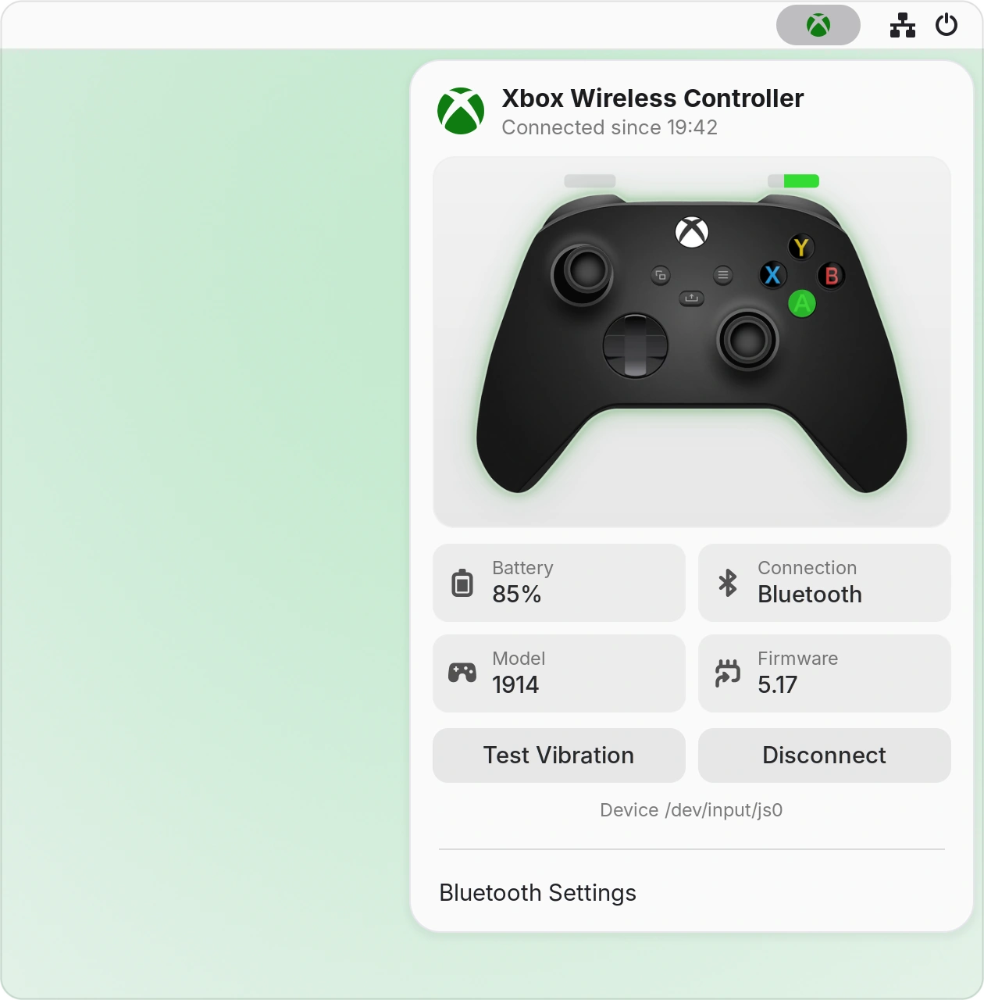
  </picture>
</p>

<p align="center">
  <sub>Every picture on this page is Padlight itself, captured in a test session of GNOME Shell 50. The wired controller is real; the Bluetooth ones, their battery readings and the buttons being pressed are simulated.</sub>
</p>

> [!NOTE]
> Padlight is an independent project. It is not affiliated with, endorsed by or connected to Microsoft. Xbox is a trademark of Microsoft.

## A look around

### It moves when you do

<p align="center">
  <picture>
    <source media="(prefers-color-scheme: dark)" srcset="docs/images/live-dark.webp">
    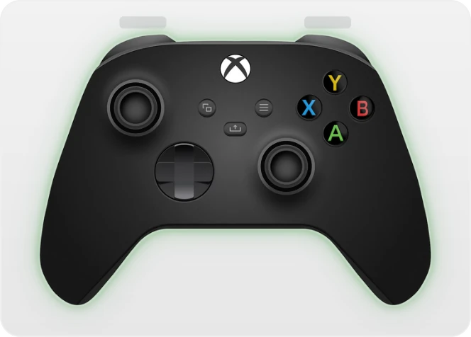
  </picture>
</p>

While the menu is open, the picture follows the controller: buttons light up green, the sticks tilt and the triggers fill as you pull them. Close the menu and Padlight stops reading the controller.

### Every state at a glance

<table>
  <tr>
    <td width="33%" valign="top">
      <picture>
        <source media="(prefers-color-scheme: dark)" srcset="docs/images/wired-dark.webp">
        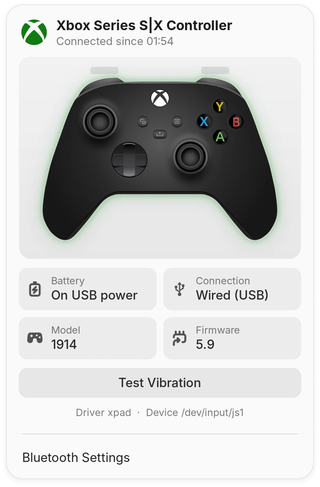
      </picture>
      <br><sub><b>On a cable.</b> The Series X|S controller over USB, running on USB power.</sub>
    </td>
    <td width="33%" valign="top">
      <picture>
        <source media="(prefers-color-scheme: dark)" srcset="docs/images/charging-dark.webp">
        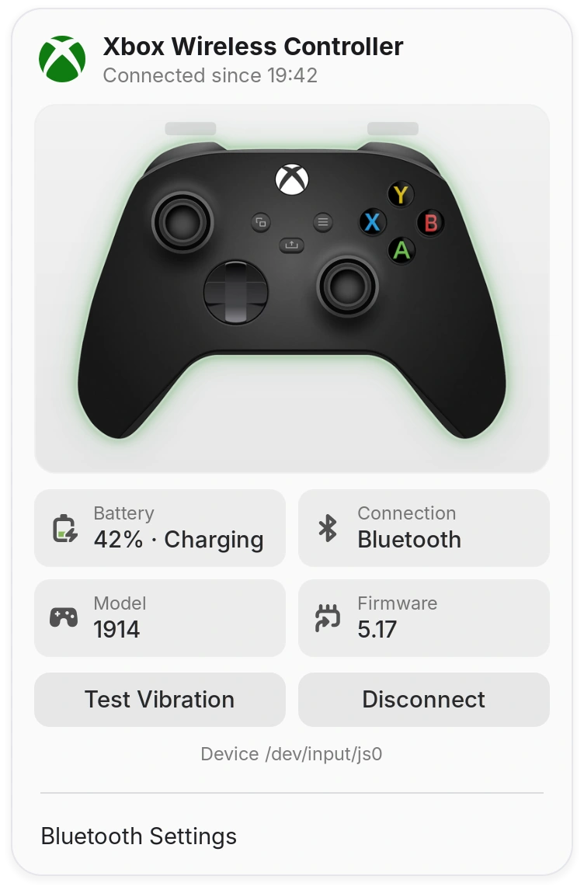
      </picture>
      <br><sub><b>Charging over Bluetooth.</b> The battery comes from UPower, and a Bluetooth controller gets a Disconnect button.</sub>
    </td>
    <td width="33%" valign="top">
      <picture>
        <source media="(prefers-color-scheme: dark)" srcset="docs/images/low-dark.webp">
        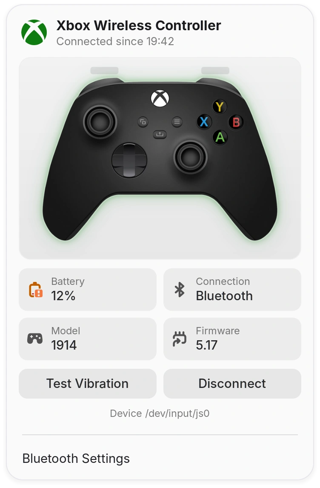
      </picture>
      <br><sub><b>Running low.</b> At 20% and below, the battery icon turns orange.</sub>
    </td>
  </tr>
  <tr>
    <td valign="top">
      <picture>
        <source media="(prefers-color-scheme: dark)" srcset="docs/images/two-dark.webp">
        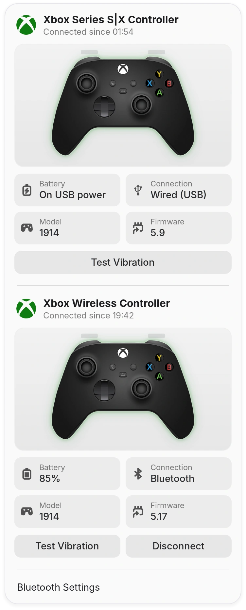
      </picture>
      <br><sub><b>Two at once.</b> Every controller gets its own card, a little smaller so they all fit.</sub>
    </td>
    <td valign="top">
      <picture>
        <source media="(prefers-color-scheme: dark)" srcset="docs/images/empty-dark.webp">
        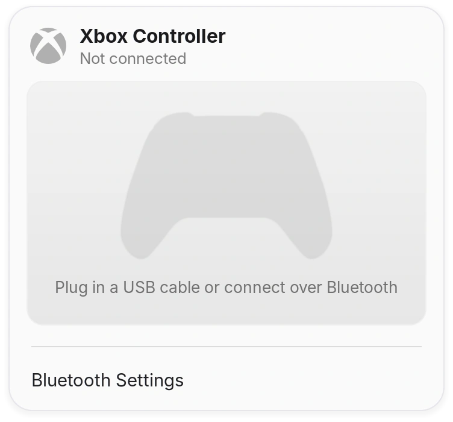
      </picture>
      <br><sub><b>Nothing connected.</b> A dimmed outline and a hint on how to connect.</sub>
    </td>
    <td valign="top">
      <picture>
        <source media="(prefers-color-scheme: dark)" srcset="docs/images/topbar-off-dark.webp">
        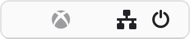
      </picture>
      <br>
      <picture>
        <source media="(prefers-color-scheme: dark)" srcset="docs/images/topbar-on-dark.webp">
        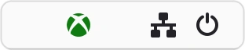
      </picture>
      <br><sub><b>In the top bar.</b> Grey while nothing is connected, green while a controller is.</sub>
    </td>
  </tr>
</table>

## What it shows

<table>
  <tr>
    <td width="170" valign="top"><strong>Status at a glance</strong></td>
    <td>The icon in the top bar is green while a controller is connected and dimmed while none is.</td>
  </tr>
  <tr>
    <td width="170" valign="top"><strong>Battery</strong></td>
    <td>The charge, and whether it is charging, for controllers whose driver reports it to UPower. On a cable it reads <em>On USB power</em>. At 20% and below, the battery icon turns orange; the level can be changed in Padlight Settings.</td>
  </tr>
  <tr>
    <td width="170" valign="top"><strong>Connection</strong></td>
    <td>Wired (USB), Bluetooth or the Xbox Wireless Adapter, and the time the controller connected.</td>
  </tr>
  <tr>
    <td width="170" valign="top"><strong>Model and firmware</strong></td>
    <td>The model number on the controller's label, such as 1914 for the Series X|S controller, and the firmware version it reports. The driver and the device file are listed underneath.</td>
  </tr>
  <tr>
    <td width="170" valign="top"><strong>Live picture</strong></td>
    <td>Buttons, sticks, triggers and the d-pad, mirrored as you press them while the menu is open.</td>
  </tr>
  <tr>
    <td width="170" valign="top"><strong>Test Vibration</strong></td>
    <td>A short rumble to check the motors, on controllers that can vibrate.</td>
  </tr>
  <tr>
    <td width="170" valign="top"><strong>Disconnect</strong></td>
    <td>Disconnects a Bluetooth controller from the computer, through <code>bluetoothctl</code>.</td>
  </tr>
  <tr>
    <td width="170" valign="top"><strong>Several controllers</strong></td>
    <td>One card each, made smaller when there is more than one.</td>
  </tr>
  <tr>
    <td width="170" valign="top"><strong>Bluetooth Settings</strong></td>
    <td>Opens the Bluetooth page of Settings, to pair a new controller.</td>
  </tr>
  <tr>
    <td width="170" valign="top"><strong>Padlight Settings</strong></td>
    <td>Opens Padlight's settings window, which the Extensions app also opens. For now it holds one setting: the battery level that counts as low, from 5% to 50%.</td>
  </tr>
  <tr>
    <td width="170" valign="top"><strong>Your theme</strong></td>
    <td>The card takes its colors from the menu around it, so it suits dark and light styles and other shell themes.</td>
  </tr>
</table>

## Get started

You need **GNOME Shell 50**; other versions refuse to load Padlight. You also need **Python 3**, which most distributions include: it runs the two small helpers behind the live picture and the vibration test.

```sh
git clone https://github.com/NahuelGenchi/padlight.git
cd padlight
./install.sh
```

Then log out and back in, because GNOME Shell only loads a new extension when you log in. The controller icon appears on the right of the top bar.

| To | Run, from the `padlight` folder |
| :--- | :--- |
| Update | `git pull`, then `./install.sh` again, then log out and back in |
| Remove | `./install.sh --uninstall` |
| Build the package for extensions.gnome.org | `./install.sh --pack` |

<details>
<summary><strong>What the installer does</strong></summary>

<br>

`install.sh` packs `src/` with `gnome-extensions pack`, installs it in `~/.local/share/gnome-shell/extensions/padlight@nahuelgenchi.github.io/` with `gnome-extensions install`, and switches it on for your user. It needs no administrator rights and changes nothing outside your home folder. Once installed, Padlight also appears in the Extensions app, where you can switch it off and on and open its settings.

Padlight keeps its settings with your other GNOME settings, under `/org/gnome/shell/extensions/padlight/`. Removing Padlight leaves them in place; `dconf reset -f /org/gnome/shell/extensions/padlight/` clears them.

Developed on Ubuntu 26.04 with GNOME Shell 50.1 on Wayland. Other distributions have not been tried yet.

</details>

## Controllers

| Controller | Connection | Status |
| :--- | :--- | :--- |
| Xbox Series X\|S controller (model 1914) | USB cable, `xpad` driver | Tried on real hardware |
| Xbox Series X\|S controller | Bluetooth | Tried with a simulated controller only ([#3](https://github.com/NahuelGenchi/padlight/issues/3)) |
| Xbox controllers | Xbox Wireless Adapter | Not tried yet ([#3](https://github.com/NahuelGenchi/padlight/issues/3)) |
| Other Xbox and Xbox-compatible controllers | USB or Bluetooth | Recognized, not tried on hardware yet; the picture is always the Series X\|S controller ([#4](https://github.com/NahuelGenchi/padlight/issues/4)) |

Padlight recognizes a controller by Microsoft's vendor ID, by an Xbox name, or by the `xpad`, `xpadneo` or `xone` driver. It leaves out the virtual controllers that Steam Input and game streaming create, so each real controller appears once.

## How it works

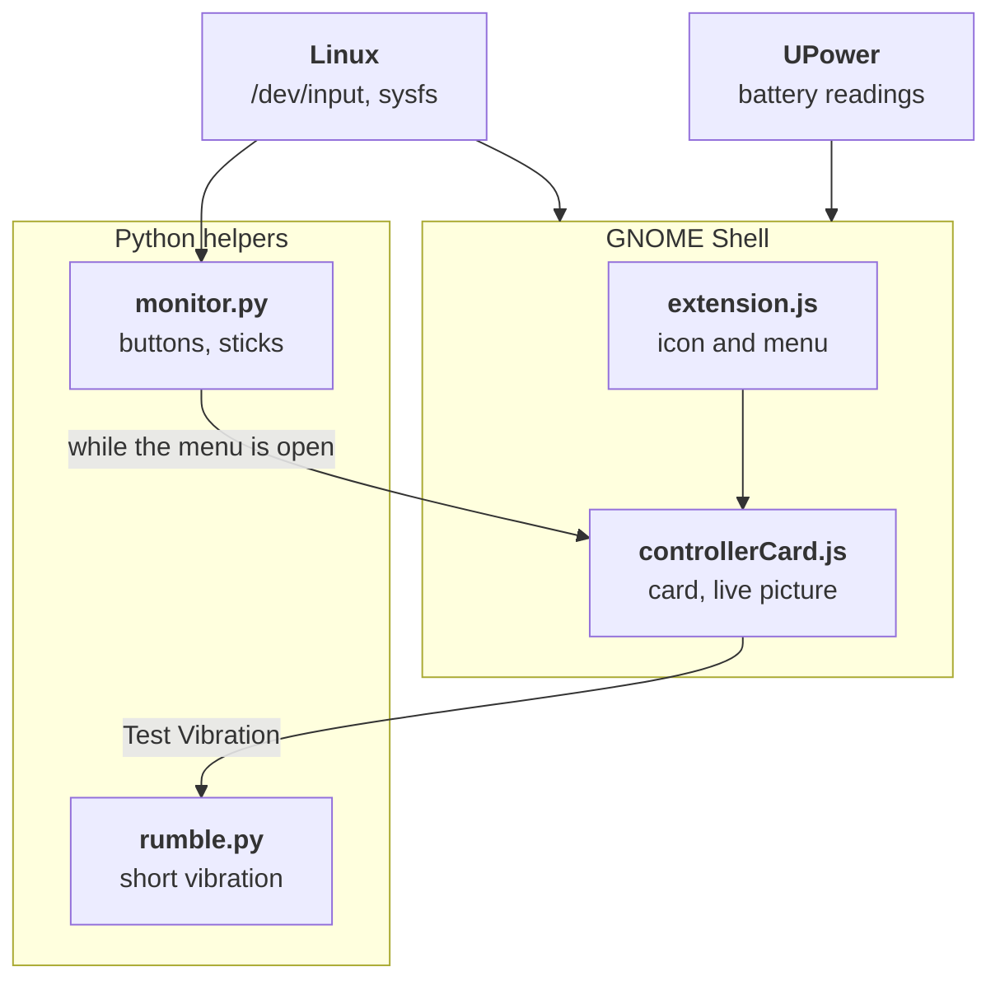

Padlight watches `/dev/input`, so a controller shows up about half a second after it connects, wired or not. For each one it reads what the kernel knows: the name, the vendor and product, the firmware version, the driver and the Bluetooth address. Battery readings come from UPower. While the menu is open, `monitor.py` passes the controller's button and stick changes to the card, which redraws the picture; when the menu closes, the helper stops.

- **Games keep every input.** The helpers read the controller without taking it over.
- **Nothing leaves your computer.** No network, no administrator rights, no background service. With the menu closed, Padlight only listens for controllers coming and going and for battery changes.

| Path | What is in it |
| :--- | :--- |
| `src/extension.js` | The top-bar button: finds controllers, keeps the menu current, starts the helpers |
| `src/controllers.js` | Finds Xbox controllers in sysfs: connection, model, firmware, driver, device |
| `src/battery.js` | Battery readings from UPower |
| `src/controllerCard.js` | The card: header, picture, tiles, buttons, and the empty state |
| `src/controllerView.js`, `src/controllerArt.js` | The live picture, drawn with cairo |
| `src/monitor.py`, `src/rumble.py` | The helpers: input changes as they happen, and a short vibration |
| `src/stylesheet.css` | The card's look on dark and light menus |
| `src/prefs.js`, `src/schemas/` | The settings window, and the settings it keeps |
| `src/icons/` | Top-bar icon, USB icon, the controller artwork and its glow |
| `install.sh` | Install, update, pack or remove |

## Roadmap

Padlight is young. What is on this page works today. Next on the list:

- **An icon of its own** for the top bar, instead of the Xbox logo ([#5](https://github.com/NahuelGenchi/padlight/issues/5)).
- **Bluetooth and the Xbox Wireless Adapter**, tried on real hardware ([#3](https://github.com/NahuelGenchi/padlight/issues/3)).
- **Pictures of other controllers**, such as the Elite Series 2 and the Xbox One controller ([#4](https://github.com/NahuelGenchi/padlight/issues/4)).
- **extensions.gnome.org**, to install it with one click ([#6](https://github.com/NahuelGenchi/padlight/issues/6)).

| Milestone | Outcome |
| :--- | :--- |
| [M0 — Project foundation](https://github.com/NahuelGenchi/padlight/milestone/1) | Repository, documentation and the way work is tracked |
| [M1 — Indicator and live view](https://github.com/NahuelGenchi/padlight/milestone/2) | The top-bar icon, the card and the live picture, and their fixes |
| [M2 — More controllers](https://github.com/NahuelGenchi/padlight/milestone/3) | Other Xbox models and their pictures, Bluetooth and the adapter on real hardware |
| [M3 — Release](https://github.com/NahuelGenchi/padlight/milestone/4) | Packaging, the extensions.gnome.org listing and versioned releases |

## Contributing

Every change, however small, follows the same trail:

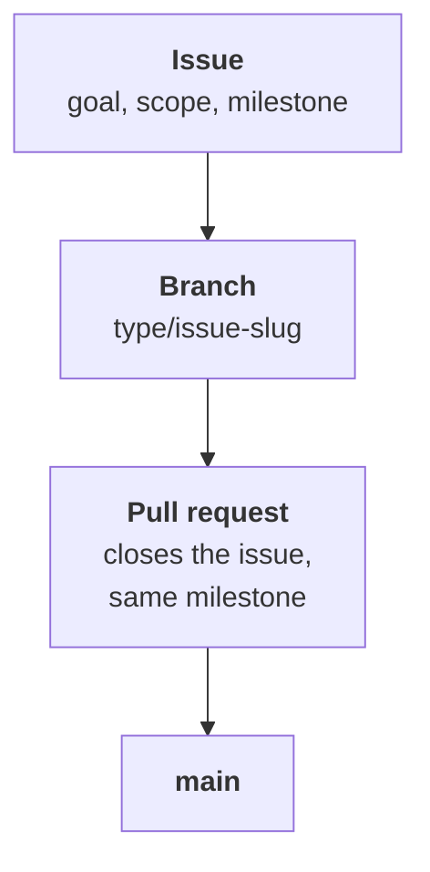

Found a bug or have an idea? [Open a work item](https://github.com/NahuelGenchi/padlight/issues/new/choose). Before sending code, read [CONTRIBUTING.md](CONTRIBUTING.md) and [docs/TRACKING.md](docs/TRACKING.md); agents start with [AGENTS.md](AGENTS.md).

## Credits

- The **controller picture** is artwork by Nahuel Genchi.
- The **top-bar icon** is the Xbox logo, a trademark of Microsoft, used to name the controllers Padlight works with. An icon of Padlight's own is planned ([#5](https://github.com/NahuelGenchi/padlight/issues/5)).
- The **Padlight logo** was drawn for this project.

## License

Padlight is free software under the **GNU General Public License, version 2 or any later version** ([GPL-2.0-or-later](LICENSE)). You may use, share and change it; if you share a changed version, share its source under the same terms. The license covers the code, the controller artwork and the Padlight logo. It does not cover the Xbox logo in `src/icons/xbox-symbolic.svg`, which remains Microsoft's trademark.
